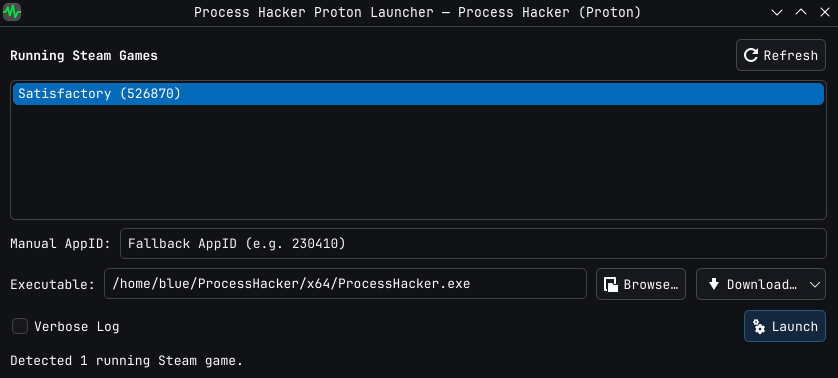

# Process Hacker Proton Launcher

[](https://github.com/BlueCatsz/ph-proton-launcher/actions/workflows/ci.yml)

A lightweight PyQt6 Linux desktop utility (Wayland & X11, native KDE Plasma integration) for launching **Process Hacker**, **System Informer**, or any custom Windows `.exe` directly inside a running Steam Proton prefix via `protontricks-launch`.



## What Is This?

On Linux, Steam runs Windows games inside isolated Proton/Wine prefixes. If you want to attach **Process Hacker** or **System Informer** to a running game (to inspect threads, modules, memory, or handles inside that prefix), you normally have to find the game's Steam AppID and manually run:

```bash
protontricks-launch --no-bwrap --appid <APPID> /path/to/ProcessHacker.exe
```

**Process Hacker Proton Launcher** automates the entire workflow:
1. Scans running Linux processes (`/proc/<pid>/cmdline`) for active `SteamLaunch AppId=<ID>` games.
2. Resolves each AppID to its game title across all configured Steam libraries (`libraryfolders.vdf` + `appmanifest_<APPID>.acf`, supporting native Steam, Flatpak Steam, and Snap Steam).
3. Can automatically download, SHA-256 verify, and extract a portable copy of **Process Hacker 2.39** or **System Informer** for you.
4. Launches your executable inside the chosen game's Proton prefix with one click—or silently in `--auto` mode when only one game is running.

## Features

- **Built-In Portable Auto-Downloader:** Click **Download…** (or launch when no `.exe` is present) to fetch, SHA-256 verify, and unpack **Process Hacker 2.39** (recommended for Wine/Proton compatibility) or **System Informer** (latest stable) into `~/.local/share/ph-proton-launcher/tools/` with portable `.settings.xml` mode enabled automatically.
- **1-Click Silent `--auto` Mode (Default Launcher Action):** When exactly **1** Steam game is running, launches silently in the background with no GUI window or terminal and sends a desktop notification (`notify-send`). Suppresses false popups when a long-running session exits because you closed the game first, and falls back to the GUI if **0** or **2+** games are running.
- **Compact Native Qt6 UI:** Lists running games as `Game Name (AppID)` (preserving your selection across **Refresh** / `F5`), double-click launch, manual numeric AppID fallback, an editable executable path picker, and a **Stop** button when a launch is active.
- **Live Collapsible Verbose Log:** Toggleable monospace log drawer powered by `QProcess` that streams `stdout`/`stderr` live inside the window and passes `-v` to `protontricks-launch` (no external terminal window spawned).
- **Native & Flatpak Protontricks Support:** Uses `protontricks-launch` from `PATH`, automatically falling back to `flatpak run --command=protontricks-launch com.github.Matoking.protontricks` and passing `--filesystem=<tool_dir>` so Flatpak Protontricks can read your executable without extra manual overrides.

## Intended Use & Anti-Cheat Note

This tool is intended for **debugging, inspecting Proton/Wine threads, loaded DLLs, handles, troubleshooting hung games, and offline/single-player modding**. Do **not** attach Process Hacker or System Informer to online/multiplayer games protected by anti-cheat systems.

---

## Prerequisites

1. **Python 3.10+** and **PyQt6** (if PyQt6 isn't installed system-wide, `./install.sh` automatically creates a local `.venv` and installs it).
2. **`protontricks`** (native package or Flatpak `com.github.Matoking.protontricks`).
3. **`notify-send` / `libnotify`** *(optional, for desktop notifications in `--auto` mode)*.
4. **Process Hacker 2** or **System Informer** *(optional ahead of time—you can download either directly inside the app via **Download…** or `--download`)*.

### Distro Package Commands

- **Arch / CachyOS:**
  ```bash
  sudo pacman -S python-pyqt6 protontricks libnotify
  ```
- **Fedora:**
  ```bash
  sudo dnf install python3-pyqt6 protontricks libnotify
  ```
- **Debian / Ubuntu:**
  ```bash
  sudo apt install python3-pyqt6 protontricks libnotify-bin
  # Or if using the installer's automatic venv fallback without system python3-pyqt6:
  sudo apt install python3-venv protontricks libnotify-bin
  ```
- **SteamOS / Bazzite / Immutable Distros (Flatpak Protontricks):**
  ```bash
  flatpak install flathub com.github.Matoking.protontricks
  ```

---

## Installation

No `sudo` is required. Everything installs cleanly into your user home directories (`~/.local/share/ph-proton-launcher/` and `~/.local/share/applications/ph-proton-launcher.desktop`).

```bash
git clone https://github.com/BlueCatsz/ph-proton-launcher.git
cd ph-proton-launcher
./install.sh
```

What `./install.sh` does:
1. Copies the application to `${XDG_DATA_HOME:-$HOME/.local/share}/ph-proton-launcher/`.
2. Uses system `python3` if `PyQt6` is already installed; otherwise creates an isolated `.venv` inside the install folder and installs `requirements.txt`.
3. Installs the `.desktop` entry with `Terminal=false`, `--auto` as the default click action, and right-click Desktop Actions for **Open Launcher UI** and **Open with Verbose Logging**.
4. Validates the `.desktop` file (`desktop-file-validate`) and refreshes desktop/KDE caches (`update-desktop-database`, `kbuildsycoca6`/`kbuildsycoca5`).

---

## Usage

### Desktop Launcher (Application Menu / KRunner)
- **Normal click:** Runs `--auto` (silent quick-launch if 1 game is running; opens UI if 0 or 2+ games are running).
- **Right-click → Open Launcher UI:** Always opens the GUI window.
- **Right-click → Open with Verbose Logging:** Opens the GUI window with the live Verbose Log drawer expanded.

### CLI Flags

```bash
~/.local/share/ph-proton-launcher/ph-proton-launcher                         # Open GUI
~/.local/share/ph-proton-launcher/ph-proton-launcher --auto                  # Silent quick-launch if 1 game is running
~/.local/share/ph-proton-launcher/ph-proton-launcher --verbose               # Open GUI with Verbose Log expanded
~/.local/share/ph-proton-launcher/ph-proton-launcher --download process-hacker   # Download Process Hacker 2.39 & save config
~/.local/share/ph-proton-launcher/ph-proton-launcher --download system-informer  # Download latest System Informer & save config
```

## Configuration

Your selected executable path is saved atomically to `${XDG_CONFIG_HOME:-$HOME/.config}/ph-proton-launcher/config.json`:

```json
{
  "process_hacker_exe": "/home/user/ProcessHacker/x64/ProcessHacker.exe"
}
```

## Development & Testing

Run the unit and headless Qt test suite:

```bash
QT_QPA_PLATFORM=offscreen PYTHONPATH=. python3 -m unittest discover -s tests -v
```

## Uninstall

```bash
./uninstall.sh
```

Removes `~/.local/share/ph-proton-launcher/` and `~/.local/share/applications/ph-proton-launcher.desktop` while preserving your saved config.

## AI Assistance Disclaimer

This project was designed, written, and reviewed with AI assistance, then verified with automated unit/headless Qt tests and live testing on Linux (KDE Plasma 6 Wayland). Because the codebase is small and dependency-light (pure Python standard library + PyQt6), you are encouraged to read through the source files before running them—issues, code reviews, and pull requests are welcome.

## License

[MIT](LICENSE)
